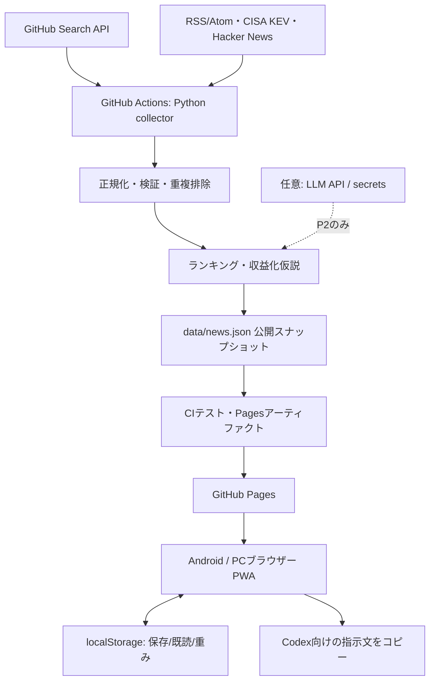

# Curiosity Radar — システム設計書

- Document ID: CR-ARCH-001
- Version: 1.0 / 2026-10-23
- Status: 実装指針（現行実装と目標設計を区別）
- 前提: 個人利用・GitHub主体・Androidから閲覧・低コスト・秘密情報を公開しない
- 対応要件: [USER_STORIES.md](USER_STORIES.md) / 開発順序: [IMPLEMENTATION_PLAN.md](IMPLEMENTATION_PLAN.md)

## 1. 結論・重要な設計判断

1. **GitHub Actionsで集め、GitHub Pagesで配信する。** スマホのTermuxは開発・故障時の予備手段であり、稼働が必要な本番サーバーにはしない。
2. **既存のビルド不要HTML/CSS/JS + Python標準ライブラリを維持する。** 構成変更は実証された必要性がある場合だけADRと小さなPRで行う。
3. **公開コンテンツと個人設定を完全分離する。** 公開フィード `data/news.json` は誰でも閲覧可能。保存・既読・重みはブラウザーのlocalStorageのみ。
4. **記事と推測を混同しない。** 元記事の情報／機械的指標／解釈／ビジネス仮説の根拠と確度を分離し、未知を「未確認」と表示。
5. **自動化は法令・利用規約の範囲内。** Xの画面操作RPAによる自動収集は実装しない。公開RSS/API・公式許諾手段を優先する。
6. **収集障害は『静かに成功したふり』をしない。** 失敗したソース、古いデータ、キャッシュ状態を観測・表示する。
7. **Codexは各フェーズをPR単位で実装、テスト、差分レビューする。** 自律的な全面書き換えや無制限な外部API利用は行わない。

## 2. コンテキスト・アーキテクチャ



- 本番データフローは **外部ソース → Actions → JSON → Pages → ブラウザー** の一方向。ユーザーのブラウザー設定は外へ送らない。
- サーバーレスの意味: 任意の動的バックエンドを常駐させない。GitHub Actionsによるバッチ処理はある。
- GitHub Pagesの公開URLは公開情報。認証や非公開DB代わりに使わない。
- 初回の想定公開先: `https://miiifa.github.io/curiosity-radar/`（リポジトリ作成・Pages設定後の候補URLであり、公開済みではない）。

## 3. 現行実装との対照

| 層 | 現行ファイル | 確認できた実装 | 残る設計課題 |
|---|---|---|---|
| UI | `index.html`, `styles.css` | 日本語画面、カテゴリ、モバイルナビ、設定 | アクセシビリティ監査、端末別回帰 |
| フロント | `app.js` | JSONロード、検索/並べ替え、保存/既読、重み、CopilotではなくCodex用コピー | データスキーマ検証、オフライン明示、厳密な順位説明 |
| データ | `data/news.json` | デモスナップショットあり | 本番ソース取得後の品質・鮮度を実検証 |
| 収集 | `scripts/collect.py` | GitHub検索、各RSS、KEV、HN、収益仮説、URL重複 | コレクタ分割、取得元監視、類似内容重複、APIエラー統一 |
| 配信 | `.github/workflows/publish.yml` | 手動＋2回/日、収集・テスト・Pagesデプロイ | PR検証、権限最小化、配信先スモークテスト |
| PWA | `sw.js` | 静的ファイルキャッシュ、フィードのネット優先 | オフライン中の明示、古いJSONの警告、版管理 |
| テスト | `tests/test_collect.py` | パース・日付・重複等のユニットテスト | JSON契約・障害パターン・ブラウザー自動テスト |

> **注意:** 上の「確認できた実装」はソースコードの読解によるもので、実際の本番URL・GitHub Actions実行結果を保証するものではない。

## 4. データソース一覧と原則

| 区分 | 候補ソース | 取得方法 | 収集データ・注記 |
|---|---|---|---|
| GitHub | GitHub Search API | API（既存GH_TOKEN） | リポジトリ情報・スター・更新・ライセンス。API上限内 |
| AI | 公式発表＋Google News RSS | RSS/API | 新製品・エージェント・研究。RSSニュースと公式発表を識別 |
| 国内旅行 | Google News RSS、地域観光公式・イベント公式RSS（追加候補） | RSS/API | 季節イベント・温泉・ドライブ。アクセス/営業は出典要確認 |
| セキュリティ | JVN、JPCERT/CC、IPA | RSS | 注意喚起、脆弱性情報 |
| セキュリティ | CISA KEV | 公式JSON | `dateAdded`はKEVへの追加日、発見日・攻撃日ではない |
| セキュリティ | Cisco Talosブログ | RSS | Talos脅威研究。ユーザーの「VRT」と同一意図かは未確認 |
| ネット話題 | Hacker News Algolia | API | ITコミュニティでの注目度。Xとは別 |
| ネット話題 | Blueskyの公開AppView | 公開API（後続） | 公開投稿。規約・取得条件を実装前に再確認 |
| X | X公式API/公式埋め込み（将来） | 許可された方法のみ | MVPでは取得しない。無許可RPA・スクレイピング禁止 |
| 収益アイデア | 公開OSS+個人開発関連記事 | 元ネタからルールベース生成 | 事業仮説。検証なしで需要や利益を宣言しない |

**新規ソース追加条件:** ①出典・URL実在 ②API/RSS公開条件確認 ③利用規約・レート制限に適合 ④再配布するフィールド最小化 ⑤日時の意味を確認 ⑥パーサと失敗テスト追加。

**ソース不確実性:** RSSエンドポイントは変更/廃止され得る。初回Actions実行でHTTP応答・日付・件数を実際にチェックして採否を確定する。Google News RSSは検索結果のため厳密な網羅性は主張しない。

## 5. データ契約（JSON Schemaの設計案）

既存 `data/news.json` を読み込み互換とし、将来のバージョン管理を追加する。下記は**目標形の例**であり、現行JSONの全キーではない。

```json
{
  "schema_version": 2,
  "collector_version": 2,
  "mode": "live",
  "generated_at": "2026-10-23T10:30:00Z",
  "last_success_at": "2026-10-23T10:30:00Z",
  "status": "partial",
  "sources_attempted": 16,
  "sources_succeeded": 15,
  "errors": [{"source":"example-feed", "type":"timeout"}],
  "items": [{
    "id": "github-xxxxxxxxxxxxxxxxxx",
    "category": "github",
    "content_type": "repository",
    "title": "owner/example-repo",
    "summary": "原典の説明文から生成した短い抜粋",
    "url": "https://github.com/owner/example-repo",
    "source": "GitHub Search API",
    "source_url": "https://github.com/owner/example-repo",
    "published": "2026-10-21T12:00:00Z",
    "observed_at": "2026-10-23T10:30:00Z",
    "tags": ["automation"],
    "score": 77,
    "score_basis": ["活発な更新", "カテゴリ適合"],
    "reason": "自動化用途で検証できそう（仮説）",
    "evidence_type": "metadata+heuristic",
    "stars": 312,
    "star_delta": 18,
    "star_delta_since": "2026-10-22T10:30:00Z",
    "language": "Python",
    "license": "MIT"
  }]
}
```

- `schema_version=2`は**実装後**に使う。現行のフィードは`collector_version: 1`であり、移行時はv1/v2互換を確認する。
- 必須フィールド: `id`, `category`, `content_type`（v2）, `title`, `url`, `source`、`score`。`published`は不明ならnull。
- カテゴリ列挙: `github`, `ai`, `money`, `security`, `travel`, `social`, `hobby`。
- `id`: `category + canonical source URL`に基づく安定ID。既存の保存済みIDと互換維持、移行が必要ならマッピングする。
- `score`: 0〜100（順位付けの参考値で、出典の信頼性/真偽の確率を表さない）。
- `status`: `ok` / `partial` / `failed` を候補とし、`mode`の `demo` / `live` とは分離。
- `errors`: UI側で生の例外文字列を表示しない。公開JSONではソースID・カテゴリ・短いエラー分類のみとし、機密を含むURL/トークンは除去。
- `source_url`: 著作権・引用・由来を追えるURL。`url`はユーザーが実際に開く記事ページ。
- `published`（原典公開日時）と`observed_at`（今回観測）と`generated_at`（JSON生成）を混同しない。
- X投稿情報の実体がないとき `source: X` / `content_type: tweet` を創作しない。
- `schema_version`変更時はフィードの自動テスト・フロントの表示テスト・旧localStorage互換テスト必須。

### データ量の制約（初期目標値）

- 収集上限 360アイテム/スナップショット（既存実装を尊重）。大きなフィードはカテゴリ別分割を後で検討。
- 長い本文・外部画像・プロフィール情報はフィードに保存しない。概要のみ引用条件に従い短く保持。
- サイズ目安: 1回のJSONは圧縮なしで1MB未満を目標。超える場合はテキスト圧縮や別JSON分割を検討。
- 日時・重複候補の判定はUTCで実施。表示はブラウザーのタイムゾーン（日本語UIではJST想定）を使用。

## 6. 収集・品質判定パイプライン

```text
fetch (タイムアウト14秒、制限付き再試行)
  → parse (RSS/Atom/RDF/API; HTMLタグ除去)
  → normalize (共通フィールド、UTC、URL正規化)
  → validate (HTTPS推奨、タイトル、URL、サイズ、日付、型)
  → enrich (GitHubメタデータ、KEV、ルールベース理由、収益仮説)
  → deduplicate (同一URL; 後続では関連記事クラスタ)
  → rank/diversify (関心、鮮度、実用性、重複/偏り抑制)
  → publish snapshot (原子的置換・品質ゲート)
```

### 失敗処理

- 個別フィード失敗: 正常な別ソースから更新し、失敗ソースには前回成功日時を付与。古い記事は記事単位の鮮度を示す。
- 全ソース失敗: `news.json`を書き換えず、ワークフローを失敗させる。直前の正常な公開サイトは維持される。
- 1件だけ成功: 「更新成功」と断定する前に最低件数/成功ソース数を検証（閾値は環境測定後に確定）。極端な減少時は手動確認できるよう警告。
- 新規スナップショット生成: 一時ファイルに書き出し、JSON契約・URL検査が通れば原子的置換。
- 重複スナップショット: 不要な差分/コミットを抑える。動いた時刻を利用者に誤認させない。
- GitHub Actionsの定期実行は遅延や欠落がありうる。`workflow_dispatch`で復旧可能にする。公開リポジトリで長期無活動時のスケジュール停止も運用手順に含める。

## 7. 発見スコア・推薦（解釈可能性重視）

### 現行
- Python: 元記事のカテゴリ基準・新しさ・GitHubスター/新規性を重み付け。PR-02ではスター増分を観測期間で補正し、GitHub候補枠を確保する。現行の式・閾値・任意フィールドは[GitHub発掘の判定と観測](GITHUB_DISCOVERY.md)を参照。
- ブラウザー: `item.score * (0.50 + weight * 0.17)` を表示順に利用し、連続する同カテゴリが偏らないように軽い調整。
- 「独自スコア」は統計的な確率ではない。保存/クリックによる学習はまだない。

### 推薦改善の仕様（P1、先にオフライン評価してから切替）
- `base_score`は0〜100に正規化。`personal_weight`は1〜5、`recency`は日数、`discovery`は小規模OSSの新規性、`confidence`はメタデータの欠損率などから計算する。
- 候補式（未実装）: `final = clamp(0.50*base + 0.20*interest + 0.15*freshness + 0.10*discovery + 0.05*quality - penalty, 0, 100)`。
- 変数は全て0〜100に正規化し、「おすすめ理由」に根拠を最大3件表示する。重みは定数で公開し、回帰評価で調整。
- GitHubスターの単純な絶対値より、観測時間で割った増分・活動状況・関心テーマを考慮。急増は不正なスター操作の可能性もあるので安全性/質と同一視しない。
- 1カテゴリばかりにならないよう、最初の10件は上位カテゴリ分散を図る。ただし明示的なカテゴリ選択では分散させない。
- 書き換え前に、固定フィクスチャで「新興の良候補が見つかる／無関係な大物が独占しない／同じ情報が続かない」を比較。
- ユーザー個別の興味データはクライアント上の表示順位にだけ反映。公開JSONへ個人化された順位は送信しない。

## 8. フロントエンド・UX

### 画面

1. **ホーム**: 上部に更新時刻・ライブ/デモ/障害の明示。最初の3〜5カードに発見内容、出典、理由、次の行動。
2. **GitHub**: タイトル、説明、スター、増分の観測期間、言語、ライセンス、活用候補、Codexで試す。
3. **AI・開発**: 公式発表/紹介記事の識別、技術の用途、出典。
4. **収益化**: 着想元、想定顧客、未確認事項、検証指示。試算は仮定を明記。
5. **旅行**: 地域、季節/見ごろ（根拠ある場合）、交通条件への導線。
6. **セキュリティ**: 発行元、CVE/KEV等、影響範囲の確認を促す。
7. **ネットの話題**: HN/Bluesky等を区別。X未対応を明示。
8. **保存/設定**: 調整可能な重み、既読、保存。localStorageの意味を説明。

### 表示状態

`loading` / `live-ok` / `live-partial` / `stale` / `offline-cached` / `demo` / `error` の7種をUIで明確に分岐。後続のUIテストで各状態を確認する。

### アクセシビリティ

- 360px〜desktop、操作対象44px程度目安、フォーカス可視、キーボード操作、適切なARIA。
- ローディング・エラー・保存完了を音声でも把握可能 (`role=status`, `aria-live`)。
- 色だけに頼らず、警告にラベルと更新時刻を添える。
- 動きを減らす端末設定（`prefers-reduced-motion`）を尊重する。

## 9. セキュリティ・プライバシー

| リスク | 対策・検証 |
|---|---|
| 外部RSSのHTML/JS注入 | タグ除去、フロントでエスケープ、許可URL形式検査。テストに攻撃文字列を追加 |
| API秘密鍵・プライベート会話の漏洩 | GitHub Actions secrets/envのみ使用。公開JSON、Pages成果物、ログ、コミットへ絶対出力しない |
| 供給元の悪質リポジトリ | GitHubから取得したコードを自動実行しない。README、ライセンス、依存関係、更新状況を調べてから検証 |
| 誤ったセキュリティ助言 | KEV登録、脆弱性の存在、利用者の影響、修正要否を分ける。一次資料に導く |
| 規約違反の収集 | 公開API/RSSの許諾・上限を確認。Xの無許可スクレイピング/RPAは実装しない |
| 古いデータが最新に見える | `generated_at`、原典日時、個別ソース最後成功日時、キャッシュ警告を分ける |
| プロンプトインジェクション | RSS/README/記事はすべて『解析対象の非信頼データ』。LLM導入時もプロンプト内の命令として採用しない |
| 費用暴走 | 初期はLLMなし。将来の外部APIはオプトイン、回数制限、トークン・予算上限、失敗時停止 |
| 公開設定の勘違い | Pagesは公開サービス。GitHub Freeでは公開リポジトリでPages利用。個人専用に見えても公開してよいデータのみ配置 |

- 本アプリからの情報を基に投資、旅行予約、緊急セキュリティ対応を自動実行しない。
- 依存関係追加時にはロックファイルとバージョン固定、ライセンス・脆弱性確認を求める。
- 外部リンクは `rel="noopener noreferrer"` とし、危険なURLスキームを拒否。

## 10. GitHub Actions / デプロイ設計

### イベント
- `workflow_dispatch`: 初回確認・手動復旧。
- `schedule`: 07:30と19:30 JSTを目標にUTC cronで設定。遅延は許容（正確な時刻に動く保証ではない）。
- `push` (`main`): 配信。自動生成 `data/news.json` 更新が再帰的にジョブを起動しないよう既存フィルタを尊重。
- `pull_request`: PR作業では**テストのみ**実行。Pages本番デプロイや秘密鍵の公開は禁止。

### 権限分離（P0で改善）
- テストジョブ: `contents: read`。
- フィード保存が必要なジョブのみ `contents: write`。
- Pagesデプロイジョブのみ `pages: write`, `id-token: write`。
- 収集の失敗で前回の良好スナップショットを上書きしない。公開アーティファクトにはUIと公開JSONだけ含める。
- 可能であればActionsをコミットSHA固定し、更新戦略を文書化。

### 受入検証
1. 手動Actions成功 → `data/news.json` はライブデータで `mode=live`、0件でない。
2. 公開URLから一覧が表示され、実在記事へのリンクが開く。更新時刻とJSON日時を照合。
3. API失敗を模擬 → 旧ライブデータが守られ、警告とジョブエラーが確認できる。
4. `pull_request` でテスト失敗 → 本番は更新されない。

## 11. 監視、運用、復旧

- GitHub ActionsのRunsと`data/news.json`で実行・取得ソース・件数・失敗原因を追跡する。
- アプリの更新時刻と実際の公開JSON時刻が一致することを1日目に検査する。
- 48時間以上経過した場合、利用者に「更新停止の可能性」を明示する。
- データが壊れたら最後に動いたコミット/Pagesアーティファクトへ戻す。リポジトリを丸ごと初期化しない。
- APIキー漏洩時はまず鍵を無効化/再発行し、公開された経路を調査する。
- ソースごとのエラーと影響範囲を短く記録。単なる一覧取得失敗と本番画面の障害を区別する。

## 12. 運用目標・品質指標（設計目標。未計測）

| 指標 | 初期目標 | 測り方 |
|---|---|---|
| 更新 | 1日2回目標 / 48時間以上未更新で警告 | `generated_at` とActions履歴 |
| 推薦品質 | 先頭10件で複数カテゴリ・1件以上保存候補 | 週1回の目視評価（自動採点の代わりにしない） |
| 取得継続 | 単一ソース障害で一覧が空にならない | モック障害テスト |
| データ品質 | 必須キー欠損・不正URL・重複IDを公開しない | 契約テスト |
| モバイル | 360/390/430pxで主要操作可能、横はみ出しなし | Playwright等の画面検証 |
| コスト | MVPは有料API不使用 | Action使用量と請求の月次確認 |

## 13. 今後の拡張に向けた選択肢

- **AI要約（P2）**: サーバー側Actionsで処理、出力を公開可能な要約に限定、キャッシュ・予算上限。端末の個人設定は送らない。
- **通知（P2）**: 緊急度判定の精度と通知先のプライバシー設計を先行。速報用途の公式情報を代替しない。
- **端末間の設定同期（P2）**: MVPではエクスポート/インポートが優先。認証とDBを安易に追加しない。
- **GitHub以外のホスティング**: 静的Pagesの制約で運用要件を満たせなくなったとき再検討。

## 14. 実装前に確定・検証が必要な事項

1. 新規GitHubリポジトリ作成、Actions/Pages利用可能権限、GitHub Free等のプラン条件。
2. 対象RSSエンドポイントが取得できること／権利とレート制限。
3. ユーザーが述べた「VRT」の具体的な団体・情報源（不明なまま同定しない）。
4. 将来のLLM連携に必要なAPIプロバイダー、予算、情報送信同意。
5. X公式API契約や埋め込み等の正規の利用条件（不明なら未実装）。
6. PWAオフライン時の最終更新・キャッシュ表示が誤解を生まないこと。

## 15. 参照資料（実装時に最新版を再確認）

- GitHub Pages: https://docs.github.com/en/pages/getting-started-with-github-pages/creating-a-github-pages-site
- Pages Actions source: https://docs.github.com/en/pages/getting-started-with-github-pages/configuring-a-publishing-source-for-your-github-pages-site
- GitHub Actions schedule: https://docs.github.com/en/actions/reference/workflows-and-actions/events-that-trigger-workflows
- GitHub repository search API: https://docs.github.com/en/rest/search/search#search-repositories
- X自動化ルール: https://help.x.com/en/rules-and-policies/x-automation
- Bluesky公開API: https://docs.bsky.app/docs/api/app-bsky-feed-get-author-feed
- JVN: https://jvn.jp/rss/jvn.rdf
- JPCERT/CC: https://www.jpcert.or.jp/rss/jpcert.rdf
- IPA: https://www.ipa.go.jp/security/
- CISA KEV: https://www.cisa.gov/known-exploited-vulnerabilities-catalog

## 16. ADR（採用決定の記録）

- ADR-01: GitHub Actions + Pagesを本番に採用。Termux常駐サーバーは不採用（スマホ電池・バックグラウンド停止・公開管理を避ける）。
- ADR-02: バックエンドDBや認証はMVPでは導入しない（費用・プライバシー・運用負荷を抑える）。
- ADR-03: 日本語のUIと本人の関心に応じた**ローカル推薦**を行う。生の会話履歴は一切保存しない。
- ADR-04: XのRPA収集を採用しない（公式ルールとの不整合）。
- ADR-05: 推薦・事業仮説を説明可能なルールベースから始め、精度評価後にLLMを検討する。
